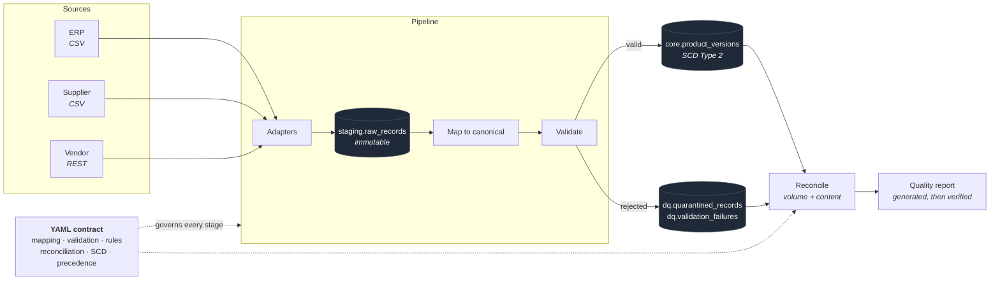

# SupplyLink

**Multi-source data integration and reconciliation for supply-chain master data.**

Three systems describe the same product. None of them agree on how to say so.

```text
ERP           SKU: WM-001     Category: Electronics    Price: 799.00   Supplier: SUP-042
Supplier CSV  product_code: wm001    category: electronics    unit_price: 799    supplier_code: SUP42
Vendor API    itemId: wm_001    dept: ELEC    price: 799.0    vendor: SUP042
```

One product. Three identifiers, three category vocabularies, three supplier
formats, three numeric representations. Multiply by forty suppliers and the
obvious response — a script per feed — gives you forty places for the same bug
and nobody who can answer *"what rules apply to this feed?"*

SupplyLink ingests all three into one canonical, versioned warehouse, and then
proves it did so without corrupting anything. **Onboarding a supplier is a YAML
file, not a new pipeline** — there is no supplier-specific Python anywhere in the
codebase.

<br>

| | |
| --- | --- |
| **Stack** | Python 3.11+ · PostgreSQL 16 · SQLAlchemy Core · Alembic · FastAPI · Typer · Docker |
| **Tests** | 391 passing · 91% coverage · unit, integration, API, and failure-path |
| **Quality** | Ruff · mypy · GitHub Actions across Python 3.11–3.13 |
| **Docs** | [Architecture](docs/architecture.md) · [Data model](docs/data-model.md) · [Contracts](docs/data-contracts.md) · [Lifecycle](docs/pipeline-lifecycle.md) · [Reconciliation](docs/reconciliation.md) · [9 ADRs](docs/decisions/) |

---

## What makes this different from an ETL script

**Reconciliation that can actually detect corruption.** Row counts cannot. If a
mapping bug divides every price by 100, every row still arrives and the count
still matches. SupplyLink computes a content checksum over the source **in
Python** and over the warehouse **in PostgreSQL** — two independent
implementations of the same canonicalisation. Comparing a checksum to one made by
the same code over the same objects proves nothing; two implementations agreeing
proves the data survived. [ADR-004](docs/decisions/ADR-004-reconciliation-strategy.md)

**Invariants enforced by the database, not by hope.** A GiST exclusion constraint
makes overlapping SCD validity periods physically impossible. A partial unique
index permits exactly one open version per SKU. `is_current` is a generated
column, so it cannot disagree with `effective_to`. Check constraints make a
successful run's counters balance. The integration tests attempt each violation
in raw SQL and watch Postgres refuse. [ADR-001](docs/decisions/ADR-001-postgresql-as-the-warehouse.md)

**A language model that cannot misreport a metric.** Every figure is computed by
the pipeline; the model only writes prose. Every numeric literal in its output is
then verified against those metrics, and an unverifiable figure rejects the whole
report in favour of a deterministic one. Instructing a model not to invent numbers
is a request — this is a check. [ADR-005](docs/decisions/ADR-005-llm-placement.md)

**Failure handling with a stated policy.** A bad *record* is quarantined with full
forensic detail and the run continues. A bad *run* — missing header, unreachable
API, contract edited without a version bump — fails and loads nothing. The line
between them is documented, tested, and encoded in the exception hierarchy.
[Lifecycle](docs/pipeline-lifecycle.md#failure-policy)

---

## Quickstart

### Docker

```bash
git clone https://github.com/mithinsagar/supplylink && cd supplylink
cp .env.example .env
docker compose up -d          # postgres + API + vendor simulator; migrates and seeds itself
docker compose run --rm cli run --source erp_core
```

API docs at <http://localhost:8000/docs>.

### Local

```bash
make install                  # virtualenv + dependencies
make db-up                    # or point SUPPLYLINK_DATABASE_URL at any Postgres 16
make migrate seed sample-data
make demo                     # the full guided walkthrough
```

`make demo` runs everything below end to end and narrates what each step proves.
CI runs it on every push, so what you read here is what the code does.

---

## An example run

A supplier drop with real problems in it:

```console
$ supplylink run --source acme_supplier

╭───────────── SupplyLink pipeline ──────────────╮
│   Run ID  8f88fc4e-4a73-4eb6-84cd-fe2018202d79 │
│   Source  acme_supplier                        │
│ Contract  v1.1.0                               │
│ Duration  0.13s                                │
│   Status  SUCCEEDED_WITH_FAILURES              │
╰────────────────────────────────────────────────╯
Records
┏━━━━━━━━━━━━━┳━━━━━━━┓
┃ Stage       ┃ Count ┃
┡━━━━━━━━━━━━━╇━━━━━━━┩
│ Received    │    62 │
│ Validated   │    44 │
│ Quarantined │    18 │
├─────────────┼───────┤
│ Inserted    │     0 │
│ Updated     │     0 │
│ Unchanged   │    16 │
│ Superseded  │    28 │
└─────────────┴───────┘
Reconciliation
┏━━━━━━━━━━━━━━━━━┳━━━━━━━━━━━━━━┳━━━━━━━━━┳━━━━━━━━┳━━━━━━━━━━━━━━━━━┳━━━━━━━━━━━━━━━━━┳━━━━━━━━━━┓
┃ Check           ┃ Dimension    ┃ Kind    ┃ Status ┃          Source ┃          Target ┃       Δ% ┃
┡━━━━━━━━━━━━━━━━━╇━━━━━━━━━━━━━━╇━━━━━━━━━╇━━━━━━━━╇━━━━━━━━━━━━━━━━━╇━━━━━━━━━━━━━━━━━╇━━━━━━━━━━┩
│ row_count       │ *            │ volume  │ PASS   │              16 │              16 │  +0.0000 │
│ quarantine_rat… │ *            │ volume  │ FAIL   │              62 │              44 │ +29.0323 │
│ duplicate_rate… │ *            │ volume  │ WARN   │              62 │               2 │  +3.2258 │
│ distinct_key_c… │ *            │ volume  │ PASS   │              62 │              60 │  +3.2258 │
│ orphan_rate_pct │ *            │ volume  │ FAIL   │              62 │               5 │  +8.0645 │
│ content_checks… │ *            │ content │ PASS   │ 6fa5fb222644c3… │ 6fa5fb222644c3… │          │
│ null_rate_pct   │ product_name │ content │ PASS   │         0.0000% │         0.0000% │  +0.0000 │
│ null_rate_pct   │ category     │ content │ PASS   │         0.0000% │         0.0000% │  +0.0000 │
│ null_rate_pct   │ supplier_id  │ content │ PASS   │         0.0000% │         0.0000% │  +0.0000 │
│ null_rate_pct   │ unit_price   │ content │ PASS   │         0.0000% │         0.0000% │  +0.0000 │
└─────────────────┴──────────────┴─────────┴────────┴─────────────────┴─────────────────┴──────────┘
Overall  FAIL

Quality report  FALLBACK  null / none
```

Read that carefully, because every line is load-bearing:

* **18 of 62 rejected, 44 loaded.** One bad row does not reject a batch.
* **28 superseded.** The ERP already masters those SKUs at a higher precedence,
  so ACME's values are counted, not applied.
* **`quarantine_rate_pct` FAIL, `content_checksum` PASS.** The feed is dirty, and
  what did load is provably intact. Those are different questions and this
  distinguishes them.
* **Exit code 2** — loaded, but reconciliation failed. A scheduler can branch on
  that.

### What was rejected, and why

```console
$ supplylink runs failures 8f88fc4e-4a73-4eb6-84cd-fe2018202d79

┏━━━━━━━━━━━━━━━━━━┳━━━━━━━━━━━━━━━━━━┳━━━━━━━━━━┳━━━━━━━━━━┳━━━━━━━━━┳━━━━━━━━┳━━━━━━━━━━━━━━━━━━━┓
┃ Rule             ┃ Field            ┃ Severity ┃ Failures ┃ Records ┃  Share ┃ Example value     ┃
┡━━━━━━━━━━━━━━━━━━╇━━━━━━━━━━━━━━━━━━╇━━━━━━━━━━╇━━━━━━━━━━╇━━━━━━━━━╇━━━━━━━━╇━━━━━━━━━━━━━━━━━━━┩
│ min              │ quantity_availa… │ error    │        6 │       6 │ 31.58% │ -1                │
│ references       │ supplier_id      │ error    │        5 │       5 │ 26.32% │ SUP-404           │
│ stocked_items_m… │ —                │ error    │        2 │       2 │ 10.53% │ quantity_availab… │
│ unique           │ canonical_sku    │ error    │        2 │       2 │ 10.53% │ CB005             │
│ allowed_values   │ currency         │ error    │        1 │       1 │  5.26% │ RS                │
│ min_length       │ product_name     │ error    │        1 │       1 │  5.26% │ ''                │
│ required         │ unit_price       │ error    │        1 │       1 │  5.26% │ —                 │
│ required         │ category         │ error    │        1 │       1 │  5.26% │ —                 │
└──────────────────┴──────────────────┴──────────┴──────────┴─────────┴────────┴───────────────────┘
```

Nothing was dropped. Every rejected record is stored whole, alongside every rule
it broke:

```console
$ supplylink runs quarantine 8f88fc4e-4a73-4eb6-84cd-fe2018202d79

record cb011  source line 8, 2 failure(s)
  payload: {'qty': '282', 'category': 'cables', 'currency': 'INR', 'unit_price': 'n/a',
            'product_code': 'cb011', 'product_name': 'usb extension cable 3m',
            'supplier_code': 'SUP68'}
  ✗ unit_price: unit_price is required but was not supplied  (expected a non-null value, got None)
  ✗ <record>: An item with stock on hand must carry a non-zero price
             (expected quantity_available == 0 or unit_price > 0,
              got quantity_available=282, unit_price=None)
```

---

## How it works



Full detail in [`docs/architecture.md`](docs/architecture.md).

---

## Onboarding a supplier is a contract

A contract is the complete description of one feed. This is the whole of what
makes ACME's messy CSV work — there is no accompanying code.

```yaml
contract:
  version: "1.1.0"                 # published versions are immutable
  effective_from: 2026-01-15

source:
  id: acme_supplier
  type: csv
  precedence: 20                   # lower is more authoritative than the ERP's 10
  csv:
    path_glob: samples/acme/*.csv
    required_headers: [product_code, product_name, category, unit_price, currency, qty, supplier_code]

mapping:
  canonical_sku:                   # 'wm001' → 'WM001'
    from: product_code
    transforms: [trim, sku_normalise]
  category:                        # 'electronics' → 'ELECTRONICS'
    from: category
    transforms: [nullify_placeholders, trim, upper]
    lookup: category_map
  supplier_id:                     # 'SUP42' → 'SUP-042'
    from: supplier_code
    transforms: [nullify_placeholders, trim, supplier_id_normalise]
  status:
    constant: ACTIVE               # this feed carries no lifecycle column

validation:
  canonical_sku:
    required: true
    regex: "^[A-Z0-9]{3,32}$"
    unique: true
  quantity_available:
    required: true
    type: integer
    min: 0                         # catches ACME's negative-stock problem
  supplier_id:
    required: true
    references:
      table: core.suppliers
      column: supplier_id

rules:
  - name: stocked_items_must_be_priced
    expr: "quantity_available == 0 or unit_price > 0"
    message: "An item with stock on hand must carry a non-zero price"
    severity: error

reconciliation:
  checksum_columns: [canonical_sku, product_name, category, supplier_id, unit_price, currency]
  thresholds:
    quarantine_rate_pct: { warn: 2.0, fail: 15.0 }   # looser than the ERP's, deliberately

scd:
  tracked_attributes: [product_name, category, supplier_id, unit_price, currency, status]
  # quantity_available is deliberately absent — it is a measure, not an attribute
```

Contracts are validated exhaustively at load time, before a single record is
read. A typo does not silently disable a rule:

```text
ContractError: validation.canonical_sku.requred: Extra inputs are not permitted
ContractError: scd.tracked_attributes contains measures ['quantity_available'].
               Tracking a measure would open a new dimension version on every run
               and bury the real changes; measures belong in core.inventory_snapshots.
ContractError: refusing to retry permanently-failing statuses [401]; these indicate
               a bad request or bad credentials, not a transient fault.
```

Business rules run in a restricted AST evaluator, never `eval` — contracts are
files plausibly edited by someone outside the core team, so
`__import__('os').system(...)` is rejected at contract load, not at record
evaluation. Full specification: [`docs/data-contracts.md`](docs/data-contracts.md).

---

## History that answers real questions

A second ERP extract arrives. Stock has moved on nearly every SKU; five products
have genuine attribute changes.

```console
$ supplylink run --source erp_core
  inserted 0   updated 5   unchanged 89
```

**89 unchanged, despite every one having a different stock level.** Quantity is a
measure and is stored as a fact; versioning it would open a new dimension row
nightly for every SKU and bury the changes that matter. The contract model
*refuses* to let a contract track a measure.

```console
$ supplylink sku history MN001

┏━━━┳━━━━━━━━━━━━━━━━━━━━━┳━━━━━━━━━━┳━━━━━━━━━━━━━━━┳━━━━━━━━┳━━━━━━━━━━━━━┳━━━━━━━━━━━┳━━━━━━━━━━━━┓
┃ v ┃ Name                ┃ Supplier ┃         Price ┃ Status ┃ Effective   ┃ Effective ┃ Changed    ┃
┃   ┃                     ┃          ┃               ┃        ┃ from        ┃ to        ┃            ┃
┡━━━╇━━━━━━━━━━━━━━━━━━━━━╇━━━━━━━━━━╇━━━━━━━━━━━━━━━╇━━━━━━━━╇━━━━━━━━━━━━━╇━━━━━━━━━━━╇━━━━━━━━━━━━┩
│ 1 │ 27 Inch QHD Monitor │ SUP-001  │ 24,999.00 INR │ ACTIVE │ 02:22:53    │ 02:22:54  │ initial    │
│ 2 │ 27 Inch QHD Monitor │ SUP-001  │ 27,499.00 INR │ ACTIVE │ 02:22:54    │ current   │ unit_price │
└───┴─────────────────────┴──────────┴───────────────┴────────┴─────────────┴───────────┴────────────┘
```

### Point in time

```console
$ supplylink sku as-of MN001 2026-03-14T09:00:00Z
```

```sql
-- sql/point_in_time_product.sql
SELECT pv.canonical_sku, pv.version_number, pv.unit_price, pv.currency
FROM core.product_versions pv
WHERE pv.canonical_sku = :sku
  AND pv.effective_from <= :as_of
  AND (pv.effective_to > :as_of OR pv.effective_to IS NULL);
```

This returns **at most one row by construction**, not by convention:

```sql
ALTER TABLE core.product_versions
    ADD CONSTRAINT product_versions_no_overlap_ex
    EXCLUDE USING gist (
        canonical_sku WITH =,
        tstzrange(effective_from, effective_to) WITH &&
    );
```

Try to write an overlapping period and Postgres refuses:

```text
ERROR:  conflicting key value violates exclusion constraint "product_versions_no_overlap_ex"
DETAIL:  Key (canonical_sku, tstzrange(effective_from, effective_to))=(MN001, [...])
         conflicts with existing key (MN001, [...]).
```

### Lineage

Every warehouse value traces back to the bytes that produced it, through foreign
keys rather than log retention:

```console
$ supplylink sku lineage MN001

v2  27 Inch QHD Monitor  27499.0000 INR
  source        erp_core record 'MN-001'
  source line   22
  payload       {'SKU': 'MN-001', 'Name': '27 Inch QHD Monitor', 'Price': '27499.00',
                 'Stock': '187', 'Category': 'Electronics', 'Supplier': 'SUP-001', ...}
  run           57e5d3be-1109-48e7-9475-a5d310e60dfd (SUCCEEDED)
  contract      v1.3.0 0cc8602fec07
  reconciled    WARN (content checksum PASS)
```

---

## Reconciliation that proves something

The content checksum is computed **twice, by two different systems**:

```python
# Python, over the mapped source records
source_digest = checksum_set(hash_row([r.values[c] for c in columns]) for r in records)
```

```sql
-- PostgreSQL, over what actually landed
SELECT encode(sha256(convert_to(string_agg(row_digest, chr(10) ORDER BY row_digest), 'UTF8')), 'hex')
FROM (
    SELECT encode(sha256(convert_to(array_to_string(ARRAY[
        coalesce(pv.canonical_sku::text, '\N'),
        coalesce(to_char(pv.unit_price, 'FM9999999999990.0000'), '\N'),
        coalesce(pv.currency::text, '\N')
    ], chr(31)), 'UTF8')), 'hex') AS row_digest
    FROM core.product_versions pv
    WHERE pv.is_current AND pv.canonical_sku = ANY(:skus)
) digests;
```

They match only if the canonicalisation, the NULL encoding, the field separator,
the decimal **rounding mode** and the column order all agree across two
independent implementations.

That last one is not a detail. Postgres rounds `NUMERIC` half away from zero;
Python's `Decimal` defaults to `ROUND_HALF_EVEN`. `0.00005` becomes `0.0000` in
one and `0.0001` in the other — one disagreement, and every affected row reports
a mismatch that is not real.

**Proof it catches what row counts miss.** The test suite alters a single price
directly in the warehouse:

```text
A single price is altered directly in the warehouse.

  row count      before 20   after 20   identical — volume reconciliation sees nothing
  content digest before c251d5565cbcfbc84e49a8ae…
                 after  caffd91ed3c7e30c753a4c2f…   MISMATCH — content reconciliation catches it
```

More in [`docs/reconciliation.md`](docs/reconciliation.md).

---

## Idempotency

```console
$ supplylink run --source erp_core     # the same file again
  status: SKIPPED
  batch fingerprint b95faaa6bfb3… was already loaded by run 37fb0d38-…;
  re-run with --force to load it again
```

Two independent guards at two grains:

| | Mechanism | Catches |
| --- | --- | --- |
| **Batch** | SHA-256 over payload hashes in order, enforced by a partial unique index | An identical re-delivery, before any work happens. Renaming the file does not defeat it — the fingerprint is over content |
| **Record** | SHA-256 over tracked attributes | *Everything else.* A partially-overlapping file has a different fingerprint, so the batch guard does not fire — and unchanged rows still produce zero churn |

Enforcement is a database constraint, not a `SELECT`-then-`INSERT` check that two
concurrent runs both pass. [ADR-006](docs/decisions/ADR-006-idempotency.md)

---

## The quality report

Structured metrics in; prose out; every number verified on the way back.

```console
$ supplylink runs quality
```

> **Summary**
> ACME Components submitted 62 records under contract 1.1.0. 44 passed validation
> and 18 were quarantined, a rate of 29.03%. This needs supplier follow-up before
> the next drop.
>
> **What failed**
> Negative inventory dominates, at 6 of 19 failures. That pattern usually means
> stock adjustments were exported without their reversing entries. A further 5
> records reference suppliers that do not exist in reference data, which normally
> means the supplier master is lagging the transactional feed rather than that the
> records are wrong.
>
> **Reconciliation**
> Overall FAIL, driven by the quarantine and orphan rates. The content checksum
> passed: the 44 records that did load are byte-identical to what ACME sent, so
> this is a source-quality problem and not a pipeline defect.

**The model computes nothing.** Every figure above is calculated by the pipeline
and passed in. The response is then verified: each numeric literal must match a
computed metric, or the report is rejected in favour of a deterministic one and
the draft is kept for inspection.

```console
$ supplylink runs quality <run-id> --json | jq .numeric_guard
{
  "verified": false,
  "numbers_checked": 12,
  "unverified": ["47", "918"],
  "policy": "every numeric literal in the generated text must match a metric the
             pipeline computed; unverifiable figures reject the report"
}
```

The guard is narrower than it looks like it should be, deliberately: numbers are
harvested only from numeric values and from strings that are entirely a number, a
timestamp or a version. Harvesting digits from arbitrary strings seems harmless
and quietly guts the guard — a run id is a UUID and a checksum is 64 hex
characters, so between them almost any number a model could invent would match
something.

**Nothing sensitive is sent.** Counts, rates, rule names, field names — never
product records, prices or supplier names. A test asserts it.

**An LLM failure never affects a load.** No key, provider down, malformed
response, guard rejection — all produce the deterministic report, which is never
less *accurate*, only less readable. It is the default in CI, so it is
continuously exercised rather than being emergency code that has never run.
[ADR-005](docs/decisions/ADR-005-llm-placement.md)

---

## API

```console
$ curl localhost:8000/health
{"status":"ok","version":"1.0.0","database":{"ok":true,...},"llm_configured":false}
```

| | |
| --- | --- |
| `GET /health` | Database, contracts, LLM configuration |
| `GET /model` | The canonical model — fields, types, roles |
| `GET /sources` | Registered feeds, contract versions, last run |
| `GET /runs` · `GET /runs/{id}` | Run history and per-stage timings |
| `GET /runs/{id}/failures` | Failure categories, ranked |
| `GET /runs/{id}/quarantine` | Rejected records with payloads and rules |
| `GET /runs/{id}/reconciliation` | Every check, labelled volume or content |
| `GET /runs/{id}/quality` · `GET /quality/latest` | The report, and the metrics it was built from |
| `GET /skus/{sku}` | Current canonical state |
| `GET /skus/{sku}/history` | Full SCD-2 history with changed attributes |
| `GET /skus/{sku}/as-of?at=…` | Point-in-time lookup |
| `GET /skus/{sku}/lineage` | Back to the source bytes |
| `POST /runs` | Trigger a run |

Every endpoint declares a response model, so nothing leaves the process that was
not deliberately put in one. Database errors are logged in full and returned as
`503 {"error": "DatabaseError", "detail": "the warehouse is unavailable"}` — a
SQLAlchemy exception stringifies to the statement, its parameters and often the
connection URL, and none of that belongs in an HTTP response. A test asserts a
planted password never reaches the client.

OpenAPI at `/docs`.

---

## CLI

```bash
supplylink run --source acme_supplier [--force] [--no-llm] [--json]
supplylink validate --source acme_supplier          # dry run, writes nothing

supplylink contracts list | validate | sync | transforms

supplylink runs list [--source X] [--limit N]
supplylink runs show <run-id>                       # with per-stage timings
supplylink runs failures <run-id>
supplylink runs quarantine <run-id>
supplylink runs quality [<run-id>]

supplylink sku show <sku>
supplylink sku history <sku>
supplylink sku as-of <sku> 2026-03-14T09:00:00Z
supplylink sku lineage <sku>

supplylink db upgrade | downgrade | seed
supplylink health
```

Every command supports `--json`. Exit codes: `0` clean, `1` run-level failure,
`2` loaded but reconciliation failed.

---

## Testing

```bash
make check     # lint + typecheck + tests
```

**391 tests, 91% coverage.** Integration tests run against a **real PostgreSQL**,
not a mock and not SQLite — the most important guarantees in this system are
enforced by Postgres, and a test double would assert that the Python is
self-consistent while proving nothing about any of them.

| Suite | Covers |
| --- | --- |
| **Unit** | Hash determinism (including across interpreter processes), transforms, the expression sandbox, contract cross-validation, mapping, every validation rule, the numeric guard, the LLM client |
| **Integration** | The full pipeline, idempotency at both grains, SCD-2 versioning and validity periods, quarantine, reconciliation, adapters, the CLI |
| **Schema** | Every constraint asserted to exist *and* to bite, by attempting violations in raw SQL |
| **API** | Every endpoint, status codes, and error sanitisation |
| **Failure paths** | Missing files, wrong encoding, absent headers, ragged rows, API timeouts, 401s not retried, retry exhaustion, LLM outage, guard rejection, concurrent duplicate loads |

A few worth singling out:

```python
def test_hashes_are_stable_across_interpreter_processes():
    """The property Python's builtin hash() lacks."""
    # Runs the hash in a subprocess under two PYTHONHASHSEED values.

def test_detects_corruption_that_row_counts_miss():
    """A price is altered directly in the warehouse. Every volume check
    still passes. The content checksum does not."""

def test_metadata_matches_the_migrated_database():
    """DDL lives in the migration; SQLAlchemy metadata mirrors it for DML.
    This turns that duplication into a checked guarantee."""

def test_identifiers_do_not_whitelist_invented_figures():
    """A run id is a UUID and a checksum is 64 hex characters. If the guard
    harvested digits from those, it would pass while guarding nothing."""
```

CI runs lint, `ruff format --check`, mypy, the suite on Python 3.11/3.12/3.13
against Postgres 16, a migration round-trip (`upgrade → downgrade → upgrade`),
**the full demo end to end**, and a Docker build that starts the stack and hits
the API.

---

## Design decisions

Nine [ADRs](docs/decisions/), each with the alternatives considered and what the
choice costs:

| | |
| --- | --- |
| [001](docs/decisions/ADR-001-postgresql-as-the-warehouse.md) | PostgreSQL as the warehouse — invariants belong in the schema |
| [002](docs/decisions/ADR-002-declarative-yaml-contracts.md) | Declarative YAML contracts — onboarding is configuration |
| [003](docs/decisions/ADR-003-scd-type-2.md) | SCD Type 2, and why measures are excluded from it |
| [004](docs/decisions/ADR-004-reconciliation-strategy.md) | Volume **and** content reconciliation |
| [005](docs/decisions/ADR-005-llm-placement.md) | The LLM interprets metrics and never computes them |
| [006](docs/decisions/ADR-006-idempotency.md) | Two-layer idempotency |
| [007](docs/decisions/ADR-007-source-precedence.md) | Source precedence for multi-source mastering |
| [008](docs/decisions/ADR-008-quarantine-grain.md) | A two-table quarantine model |
| [009](docs/decisions/ADR-009-sqlalchemy-core.md) | SQLAlchemy Core, not the ORM |

### What was deliberately not used

Airflow, Kafka, Spark, dbt, Kubernetes, Redis. One pipeline over hundreds of
thousands of rows from three feeds does not justify any of them, and adding them
would mean more to operate with nothing more to show. Each has a stated trigger
for reconsidering it in [`docs/scale.md`](docs/scale.md), alongside what changes
at 100M rows and how this maps onto AWS, Azure or GCP.

---

## Tradeoffs and limits

Stated plainly, because a project with no acknowledged limits has not been
thought about hard enough.

**A passing reconciliation does not mean the data is correct.** The source may be
wrong, and the pipeline will faithfully reproduce that. It means the pipeline did
not corrupt what it was given.

**Record-level precedence, not attribute-level.** The ERP wins wholesale on a
conflict. A mature MDM platform masters per attribute — the ERP owns price, the
supplier owns lead time. That is meaningfully more machinery, and the upgrade
path is open.

**Type 2 history is unbounded.** It grows with change volume. A volatile feed
needs a retention policy.

**`POST /runs` is synchronous.** Runs finish in well under a second at this
volume, and returning the real outcome beats returning a job id. At production
volume it would enqueue and return `202`; the run lifecycle already models that,
so the change is to one handler.

**The vendor API is a simulator.** `tools/vendor_sim/` is a test fixture that
speaks HTTP, so the REST path is genuinely runnable and its retry behaviour
genuinely testable rather than only ever mocked. It is never imported by the
application.

**Not multi-tenant.** No tenant column, no row-level security.

**Contracts are YAML.** Which brings YAML's sharp edges. Strict parsing and clear
error messages mitigate them; they do not remove them.

## Future work

* File-level watermarking, so a landing zone can hold history without replacing files
* Backfill mode, setting `effective_from` from the data rather than the clock
* Attribute-level mastering
* A read-only operations dashboard over the existing API
* `COPY`-based bulk loading and partitioning, per [`docs/scale.md`](docs/scale.md)

---

## Repository

```text
contracts/          data contracts — the ERP, a supplier CSV, a vendor REST API
migrations/         Alembic; DDL as readable SQL
sql/                analytical queries — point-in-time, lineage, reconciliation trends
src/supplylink/     the application
tests/              unit · integration · api
tools/vendor_sim/   the vendor API simulator (a test fixture, not the product)
scripts/            deterministic sample-data generator, and the demo
docs/               architecture, data model, contracts, lifecycle, reconciliation, ADRs
```

## Licence

[MIT](LICENSE).
