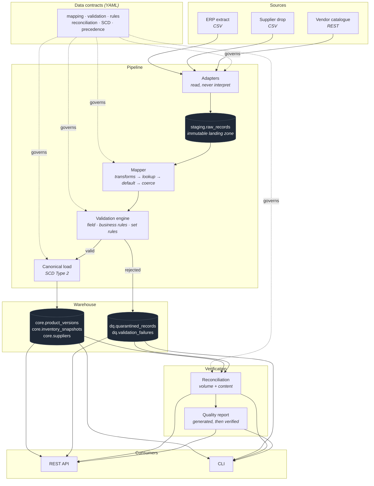

# Architecture

## The problem, precisely

Three systems describe the same product and none of them agree on how to say so:

```text
ERP           SKU: WM-001    Category: Electronics    Price: 799.00   Supplier: SUP-042
ACME CSV      product_code: wm001    category: electronics    unit_price: 799   supplier_code: SUP42
Vendor API    itemId: wm_001    dept: ELEC    price: 799.0    vendor: SUP042
```

One product. Three identifiers, three category vocabularies, three supplier
formats, three numeric representations. Multiply by forty suppliers and the
naive response — a script per feed — produces forty places for the same bug.

SupplyLink's answer is a **canonical model** that every source is translated
into by **declarative contract**, so that everything downstream of translation —
validation, history, reconciliation, the API — is written once.

## System overview



The dotted lines are the point: one contract governs every stage, and no stage
contains supplier-specific code.

## Why this shape

**Adapters read; they do not interpret.** A CSV adapter's entire job is turning
a file into an ordered stream of dictionaries. No renaming, no normalising, no
validating. The moment business logic enters an adapter, the platform is back to
one pipeline per supplier.

**Everything lands before anything is interpreted.** `staging.raw_records` holds
payloads exactly as received. That is the lineage anchor for every downstream
row, the replay source when a contract turns out to be wrong, and the evidence of
what a source actually sent when someone disputes it.

**The canonical model is the interface.** Downstream of mapping, nothing knows
where a record came from. Validation, SCD, reconciliation and the API all speak
canonical, which is why adding a source adds no code to any of them.

**Verification is a first-class stage, not a log line.** Reconciliation runs
after the load commits, against committed state, and its results are persisted
per check per run.

## Layers

| Layer | Schema | Holds | Mutability |
| --- | --- | --- | --- |
| Control plane | `meta` | sources, contract versions, runs, stages | append + status updates |
| Landing zone | `staging` | source payloads as received | **immutable** |
| Canonical | `core` | products, versions, inventory, suppliers | Type 2 versioned |
| Quality | `dq` | quarantine, failures, reconciliation, reports | append |

## Component map

```text
src/supplylink/
├── canonical.py          the shared vocabulary — field names, types, roles
├── hashing.py            deterministic canonicalisation (ADR-004)
├── clock.py              the injectable time seam
├── contracts/            contract schema, loading, registration
├── ingestion/            adapters: base, csv, rest, factory
├── transformation/       transform registry and the mapper
├── validation/           rules, expression sandbox, engine, results
├── warehouse/            runs, staging, quarantine, SCD, reference data
├── reconciliation/       metrics vocabulary, checksums, engine, store
├── quality/              metrics payload, prompts, verifier, fallback, report
├── llm/                  provider interface and the OpenAI-compatible client
├── api/                  FastAPI routes and response models
├── cli/                  Typer commands and Rich rendering
└── pipeline.py           the orchestrator: stage order and transaction boundaries
```

Dependencies point inward. `canonical.py` and `hashing.py` import nothing from
the rest of the package; `pipeline.py` imports everything and is imported by
nothing but the entry points.

## What was deliberately left out

Data engineering has a strong pull toward adding infrastructure. Each of these
was considered and rejected because the problem does not call for it:

| Not used | Why not |
| --- | --- |
| **Airflow / Prefect** | One pipeline, invoked by cron or an API call. An orchestrator would add a scheduler, a metadata database and a UI to run one DAG with no branching. Run state is already modelled in `meta.pipeline_runs`. |
| **Kafka** | Sources are files and a polled API. There is no stream, and introducing one would mean inventing producers for data that arrives in batches. |
| **Spark** | Hundreds of thousands of rows. A single Postgres instance handles this comfortably; Spark's overhead exceeds the entire workload. |
| **dbt** | Excellent for layered SQL transformation. The interesting logic here is *ingestion-side* — mapping, validation, SCD merge — which is not SQL transformation over already-loaded tables. |
| **Kubernetes** | Two containers and a database. Compose expresses that; Kubernetes would be a second system to operate. |
| **A separate data lake** | `staging.raw_records` is the landing zone, and keeping it in the same database is what makes lineage a join rather than a cross-system correlation. |
| **Redis** | Nothing needs caching. The queries are indexed and sub-millisecond at this volume. |

Each has a clear trigger for reconsidering it, listed in
[`docs/scale.md`](scale.md).

## Reading order

1. [`data-model.md`](data-model.md) — the schema and why each constraint exists
2. [`data-contracts.md`](data-contracts.md) — the contract specification
3. [`pipeline-lifecycle.md`](pipeline-lifecycle.md) — stages, transactions, failure policy
4. [`reconciliation.md`](reconciliation.md) — volume versus content, and the checksum
5. [`decisions/`](decisions/) — the nine architectural decision records
6. [`scale.md`](scale.md) — what changes at 100M rows, and in the cloud
