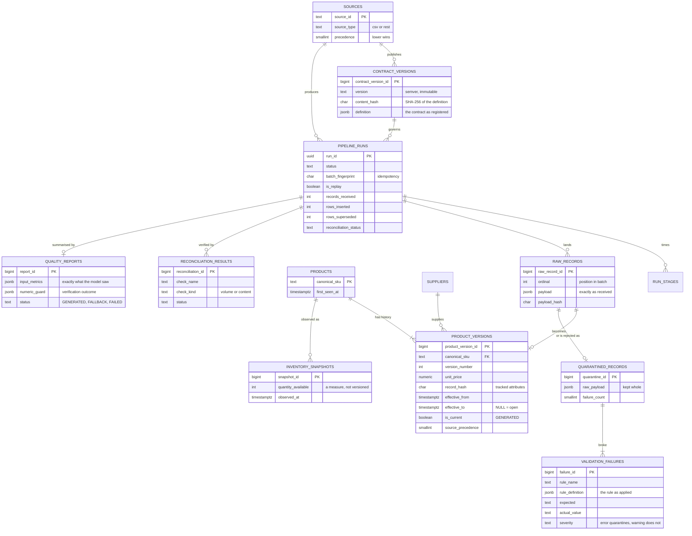

# Data model

## Entity relationships



## Keys

**Natural versus surrogate.** Both, deliberately:

* `core.suppliers` has a surrogate `supplier_key` and a natural `supplier_id`
  (`SUP-042`). Dependants carry **both**, held consistent by a composite foreign
  key onto `UNIQUE (supplier_key, supplier_id)`. Queries get a readable supplier
  code with none of the usual denormalisation risk.
* `core.products` is keyed by the natural `canonical_sku`. It is externally
  assigned, stable, and appears in every conversation about a product.
* `core.product_versions` has a surrogate primary key because its business key
  repeats by design — that is what Type 2 means.

**Why a separate `core.products` hub.** A Type 2 table cannot be a foreign-key
target: `canonical_sku` appears once per version. `core.products` holds one
durable row per SKU, so `core.inventory_snapshots` and any future fact can
reference a real key rather than relying on convention.

## Indexes

Each exists for a specific access path.

| Index | Kind | Serves |
| --- | --- | --- |
| `product_versions_current_uk` | unique, partial `WHERE is_current` | Enforces one open version per SKU **and** is the access path for every current-state read |
| `product_versions_no_overlap_ex` | GiST exclusion over `tstzrange` | Makes overlapping validity periods physically impossible |
| `product_versions_pit_idx` | btree `(canonical_sku, effective_from DESC)` | Point-in-time lookups |
| `product_versions_run_idx` | btree `(run_id)` | "What did this run write?" |
| `product_versions_supplier_idx` | btree, partial `WHERE is_current` | Supplier exposure reporting |
| `pipeline_runs_batch_idem_uk` | unique, partial | Idempotency (ADR-006) |
| `pipeline_runs_source_started_idx` | btree `(source_id, started_at DESC)` | Run listings |
| `pipeline_runs_status_idx` | btree, partial `WHERE status = 'RUNNING'` | Finding stuck runs; tiny, because almost no rows qualify |
| `validation_failures_run_rule_idx` | btree `(run_id, rule_name)` | Failure ranking |
| `raw_records_source_record_idx` | btree `(source_id, source_record_id)` | "Every time this record was delivered" |
| `inventory_snapshots_sku_time_idx` | btree `(canonical_sku, observed_at DESC)` | Latest observation per SKU |

The partial indexes are the interesting ones: `WHERE is_current` covers roughly
one row per SKU rather than one per version, so it stays small however deep
history grows.

## Constraints as design

Invariants live in the schema, so they hold even when application code is wrong.

```sql
-- Exactly one open version per SKU.
CREATE UNIQUE INDEX product_versions_current_uk
    ON core.product_versions (canonical_sku) WHERE is_current;

-- No SKU may have two versions whose validity periods overlap.
ALTER TABLE core.product_versions
    ADD CONSTRAINT product_versions_no_overlap_ex
    EXCLUDE USING gist (
        canonical_sku WITH =,
        tstzrange(effective_from, effective_to) WITH &&
    );

-- The flag cannot disagree with the window, because it is derived from it.
is_current BOOLEAN GENERATED ALWAYS AS (effective_to IS NULL) STORED

-- A successful run's counters must balance. A loader bug that loses records
-- becomes a failed transaction rather than a quietly short warehouse.
CONSTRAINT pipeline_runs_intake_balance_ck CHECK (
    status <> 'SUCCEEDED' OR records_received = records_valid + records_quarantined
),
CONSTRAINT pipeline_runs_load_balance_ck CHECK (
    status <> 'SUCCEEDED'
    OR records_valid = rows_inserted + rows_updated + rows_unchanged + rows_superseded
)

-- An error quarantines its record; a warning never does.
CONSTRAINT validation_failures_quarantine_ck CHECK (
    (severity = 'error'   AND quarantine_id IS NOT NULL)
 OR (severity = 'warning' AND quarantine_id IS NULL)
)
```

`tests/integration/test_schema.py` attempts each violation directly in SQL and
asserts the database refuses it.

## Audit columns

| Column | On | Purpose |
| --- | --- | --- |
| `run_id` | every fact and quality table | Which execution produced this |
| `raw_record_id` | versions, quarantine, failures | Which input row produced this |
| `source_id`, `source_record_id` | versions, staging, quarantine | Which system, and its own identifier |
| `source_precedence` | versions | Mastering authority **at write time**, so a later contract change cannot rewrite history |
| `content_hash` | contract versions | Which exact contract definition applied |
| `record_hash` | versions | Change detection |
| `effective_from` / `effective_to` | versions | Validity window |
| `created_at` / `updated_at` | reference data | Standard audit trail |

## Views

**`core.products_current`** — the open version joined to the most recent
inventory observation. A view rather than a table, so it cannot drift from the
data it summarises.

**`dq.run_failure_summary`** — failure categories per run, feeding both the CLI
table and the metrics handed to the quality report.
