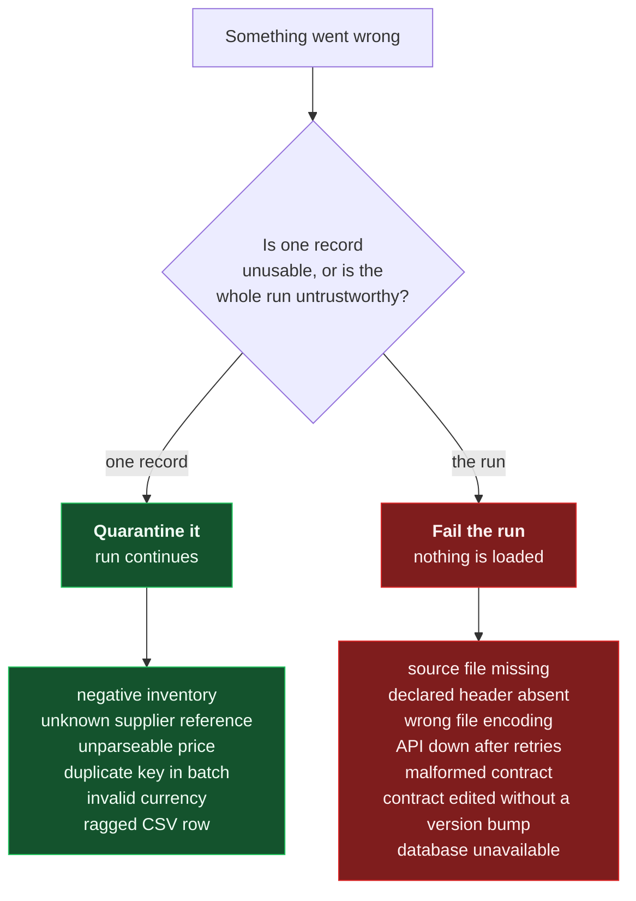
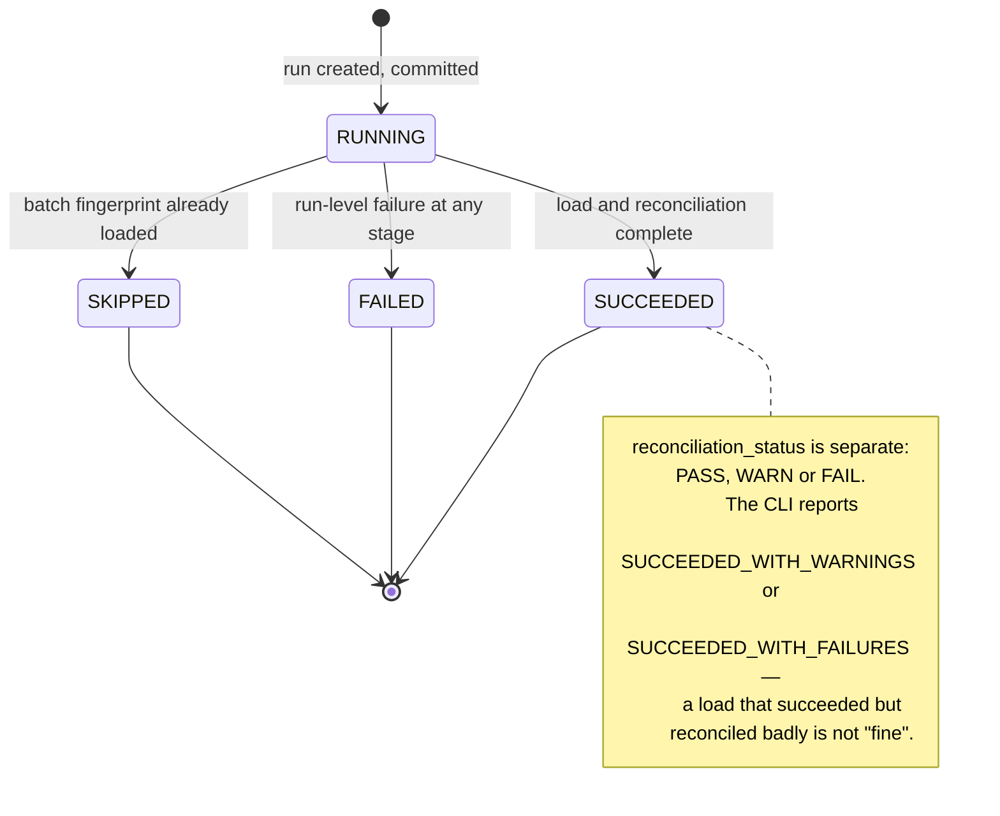
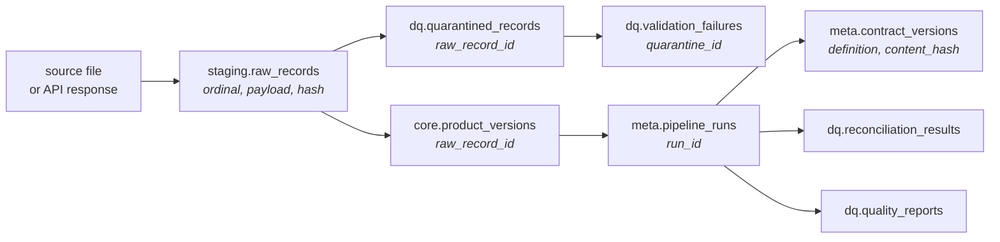

# Pipeline lifecycle

## Stages

```mermaid
flowchart LR
    start(["supplylink run<br/>--source acme"]) --> reg

    subgraph tx0["own transaction"]
        reg["Register contract<br/><i>immutability enforced</i>"]
        create["Create run<br/><i>status RUNNING</i>"]
    end

    subgraph tx1["own transaction"]
        extract["Extract"] --> map["Map to canonical"]
        map --> fingerprint["Fingerprint<br/><i>idempotency guard</i>"]
        fingerprint --> stage["Write staging"]
    end

    subgraph tx2["ONE transaction"]
        validate["Validate"] --> quarantine["Write quarantine"]
        quarantine --> load["SCD Type 2 load"]
    end

    subgraph tx3["own transaction, after commit"]
        recon["Reconcile"] --> persist["Persist results"]
    end

    subgraph tx4["own transaction"]
        finish["Finish run<br/><i>counters, verdict</i>"]
    end

    subgraph tx5["own transaction, best effort"]
        quality["Quality report"]
    end

    reg --> create --> extract
    stage --> validate
    load --> recon
    persist --> finish --> quality --> done(["done"])

    fingerprint -.duplicate.-> skipped(["SKIPPED"])

    classDef atomic fill:#7f1d1d,stroke:#dc2626,color:#fef2f2
    class tx2 atomic
```



## Transaction boundaries

These are a design decision, not an accident of where `commit()` landed.

| Stage | Boundary | Why |
| --- | --- | --- |
| Contract registration | own transaction | Must be durable before the run references it |
| Run creation | own transaction, committed immediately | **A crash must not erase its own evidence.** A run that failed still has a row saying so |
| Ingestion → staging | own transaction | Staging is the replay source; it must survive a later failure |
| Validation + quarantine + load | **one transaction** | The canonical model either advances completely or not at all |
| Reconciliation | own transaction, after the load commits | Reconciling uncommitted state proves nothing about what a reader will see |
| Run completion | own transaction | Records the outcome even if the report then fails |
| Quality report | own transaction, best effort | Narration of committed work; never able to fail a run |

Two of these deserve expanding.

**Why quarantine is inside the load transaction.** It is tempting to commit
quarantine separately so the evidence survives a failed load. It should not: if
the canonical load rolls back, no records were loaded, so quarantine rows
claiming "these 18 were rejected while 44 loaded" would describe something that
never happened. The run is `FAILED`, staging still holds every payload, and a
replay produces the truth.

**Why reconciliation is outside it.** Inside the transaction the pipeline would
be checking its own uncommitted intentions. Reconciliation must observe what a
reader would actually see, which means after commit.

## Failure policy

The hard line in this system is between a bad *record* and a bad *run*.



The principle behind the split:

* **Record-level.** Rejecting 14,000 good records because 3 are bad destroys more
  value than it protects. The 3 are quarantined with full forensic detail and
  everything else loads.
* **Run-level.** The batch is not what the contract describes. A missing header
  would silently null out a whole canonical column; a malformed contract means
  the rules are unknown. Loading a partial batch and calling it a success is how
  silent corruption starts.

This is mirrored in the exception hierarchy: `RecordError` and `PipelineError`
descend from `SupplyLinkError` and are handled in different places.

Retries follow the same logic. A REST source retries only transient statuses —
the contract model *refuses* to let a 4xx onto the retry list, because retrying a
401 four times turns an instant clear error into a slow confusing one.

## Run states



Exit codes follow: `0` clean, `1` run-level failure, `2` loaded but
reconciliation failed. A scheduler can branch on that without parsing output.

## Observability

Every log line emitted during a run carries `run_id`, `source_id` and `stage`
without any call site passing them — the context lives in `contextvars`. Two
renderers: `console` for humans, `json` for shipping.

```text
02:22:53 INFO  supplylink.warehouse.scd   canonical load complete
  run_id=57e5d3be source_id=erp_core stage=canonical_load
  inserted=0 updated=5 unchanged=89 superseded=0
```

Per-stage timings and metrics land in `meta.run_stages`, so "which stage is
getting slower?" is a query, not a log grep:

```bash
supplylink runs show <run-id>
```

## Lineage

Every hop is a foreign key, so tracing does not depend on log retention:



```bash
supplylink sku lineage MN001
```

returns the warehouse value, the source record and line that produced it, the run
and its contract version, and how that run reconciled — in one query
(`sql/lineage_trace.sql`).
