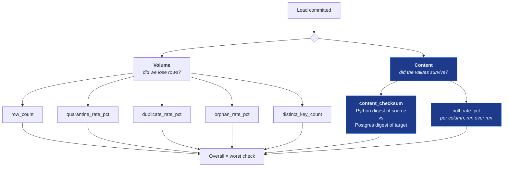

# Reconciliation

## The question worth asking

Most pipelines reconcile by comparing row counts. It is cheap, it catches
dropped rows, and it is where the effort usually stops.

It is also blind to the failure that matters most. Suppose a mapping bug divides
every price by 100. Every row arrives. The count matches exactly. Reconciliation
reports green, and the warehouse is wrong.

**Counting rows tells you nothing about whether the values survived.**

## Two kinds of check



The overall verdict is the **worst** individual check, deliberately. A run where
nine checks pass and one fails is a failed reconciliation, and averaging that
away is how bad data ships.

## The content checksum

The whole argument rests on one property:

> The source-side digest is computed **in Python** from the mapped records. The
> target-side digest is computed **by PostgreSQL** from what actually landed.

They agree only if the canonicalisation, the decimal rounding mode, the NULL
encoding, the field separator and the column order all match across two
independent implementations. Comparing a checksum against one computed by the
same code over the same in-memory objects proves only that the objects did not
change in between. Two implementations agreeing proves the data survived
mapping, serialisation, the driver, the type system and storage.

### Canonicalisation

| Value | Canonical form | Why |
| --- | --- | --- |
| `NULL` | `\N` | Must be distinguishable from an empty string — that distinction is exactly what reconciliation exists to catch |
| `Decimal("799.00")` | `799.0000` | Quantised to scale 4, matching `NUMERIC(14,4)` |
| `799` (integer) | `799` | Type-faithful: a quantity is not a price |
| `True` | `true` | Never `1`, which would collide with an integer |
| `datetime` | `2026-03-14T09:30:00` | Normalised to UTC |

Fields join with **U+001F** and rows with **U+001E** — control characters that
cannot occur in the CSV and JSON payloads this platform ingests, so no escaping
is needed.

### The rounding trap

Postgres rounds `NUMERIC` half away from zero. Python's `Decimal` defaults to
`ROUND_HALF_EVEN`. They disagree on exact halves:

```text
Decimal("0.00005").quantize(…)                    ROUND_HALF_EVEN → 0.0000
SELECT to_char(0.00005::numeric(14,4), 'FM…')                     → 0.0001
```

One disagreement, on one value, and every affected row reports a phantom
mismatch. `hashing.DECIMAL_ROUNDING` is pinned to `ROUND_HALF_UP` to match, and
a unit test asserts the two agree on half-cases.

### Never `hash()`

Python's builtin `hash()` is randomised per interpreter by `PYTHONHASHSEED` and
is useless for anything persisted. Everything here is SHA-256. A test runs the
hash in a subprocess under two different seeds and asserts the digests match.

### The generated SQL

The target-side statement is generated because the columns are contract-driven.
It is safe to generate because column names come from a closed set — checked at
contract load and again here — and every expression comes from a literal table.
No caller-supplied text reaches the statement; the SKU list is bound.

For the ERP contract's checksum columns it renders as:

```sql
WITH scoped AS (
    SELECT pv.*
    FROM core.product_versions pv
    WHERE pv.is_current
      AND pv.canonical_sku = ANY(:skus)
),
digests AS (
    SELECT encode(
        sha256(convert_to(array_to_string(ARRAY[
            coalesce(pv.canonical_sku::text, '\N'),
            coalesce(pv.product_name::text, '\N'),
            coalesce(pv.category::text, '\N'),
            coalesce(pv.supplier_id::text, '\N'),
            coalesce(to_char(pv.unit_price, 'FM9999999999990.0000'), '\N'),
            coalesce(pv.currency::text, '\N')
        ], chr(31)), 'UTF8')),
        'hex'
    ) AS row_digest
    FROM scoped pv
)
SELECT
    count(*) AS row_count,
    coalesce(
        encode(
            sha256(convert_to(string_agg(row_digest, chr(10) ORDER BY row_digest), 'UTF8')),
            'hex'
        ),
        encode(sha256(convert_to('', 'UTF8')), 'hex')
    ) AS checksum
FROM digests
```

The Python side computes the identical digest from the mapped records. If they
differ, something between the two changed the data.

## Proving it works

The test suite corrupts a single price directly in the warehouse and asserts
what each kind of check sees:

```text
A single price is altered directly in the warehouse.

  row count      before 20   after 20   identical — volume reconciliation sees nothing
  content digest before c251d5565cbcfbc84e49a8ae…
                 after  caffd91ed3c7e30c753a4c2f…   MISMATCH — content reconciliation catches it
```

That is `tests/integration/test_reconciliation.py::TestContentReconciliation::test_detects_corruption_that_row_counts_miss`,
and the demo shows the same thing live.

## Null rates are compared run over run

Every canonical attribute is `NOT NULL` in the warehouse, so a target-side null
rate is always zero and comparing against it would be theatre. What is genuinely
worth alerting on is a feed whose completeness degrades:

> `category` was 0.4% null last week and is 31% null today.

No row count will surface that. Rates are stored in the validation stage's
metrics, and the next run compares against them. The first run for a source
reports `PASS` and says explicitly that there is no baseline, rather than
implying a comparison that never happened.

## Scoping

Content reconciliation covers the SKUs a run **applied** — inserted, updated, or
confirmed unchanged. Records superseded by a more authoritative source are
excluded on purpose: their warehouse value is *supposed* to differ from what this
feed sent, and including them would report a mismatch for behaviour working
exactly as designed ([ADR-007](decisions/ADR-007-source-precedence.md)).

## Thresholds

Declared per source in the contract. Without a configured threshold a check is
**informational** — reported, but unable to fail a run. Inventing a default would
make a contract's silence mean something its author never chose.

```yaml
thresholds:
  row_count_delta_pct: { warn: 0,   fail: 0.5 }
  quarantine_rate_pct: { warn: 1.0, fail: 8.0 }
```

Grading is `FAIL` above `fail`, `WARN` above `warn`, else `PASS`.

## Persistence

Results are stored per check per run. A single failing check is an incident; the
same check failing for six runs is a different problem with a different owner.

```bash
supplylink runs show <run-id>          # this run's checks
psql -f sql/reconciliation_trend.sql   # how a check has behaved over recent runs
```

## At larger scale

| Now | At 100M rows |
| --- | --- |
| Sort row digests, then hash | `bit_xor` aggregate — associative, O(1) memory, order-independent |
| Digest computed client-side over mapped records | Push both sides into Postgres; compare against a staging table |
| Full scan of affected SKUs | Partition by `effective_from`; checksum only touched partitions |
| Every check on every run | Volume checks every run, content checksum on a schedule or on a partition sample |

Sorting is used here because the volume is small and sorted concatenation is
stronger against digest collisions than XOR. The scale path is a change to
`checksum_set` and the generated SQL, not to the model.

## What is not claimed

A passing reconciliation does **not** mean the data is correct. The source may be
wrong, and the pipeline will faithfully reproduce that.

It means the pipeline did not corrupt what it was given. Those are different
guarantees, and only the second is achievable from inside the pipeline.
