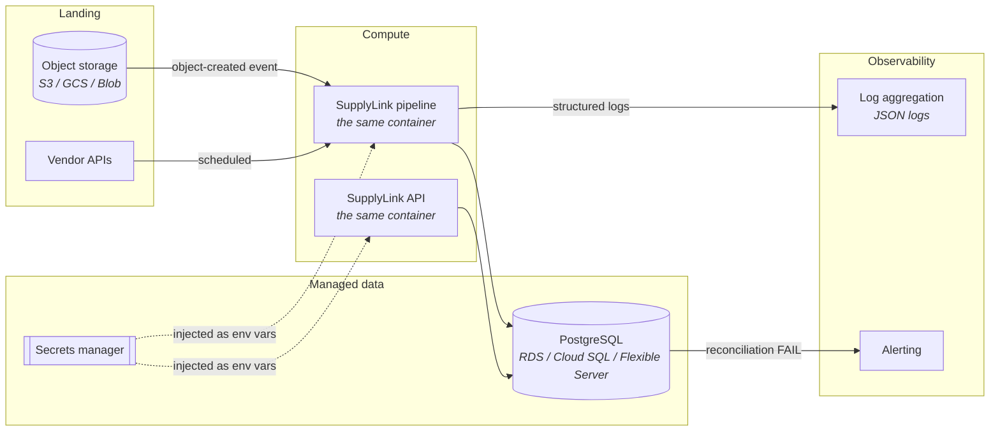

# Scale and deployment

This platform is built for the volume it actually has — hundreds of thousands of
SKUs across a handful of feeds — and deliberately avoids infrastructure that
would only pay off two orders of magnitude further on. This document is the
answer to "what would you change?", with the triggers that would prompt each
change.

## From 100k to 100M rows

| Concern | Now | At 100M | Trigger |
| --- | --- | --- | --- |
| **Bulk writes** | multi-row `INSERT … RETURNING`, chunked by `batch_size` | `COPY … FROM STDIN` into an unlogged staging table, then a set-based merge | staging writes exceed ~30s |
| **Dimension merge** | fetch current versions for the batch, decide in Python, then two statements | Load the batch into a temp table and do the close/insert entirely in SQL, one `MERGE` | the current-version fetch stops fitting comfortably in memory |
| **Checksum** | sort row digests, then hash | `bit_xor` aggregate — associative, O(1) memory, computable on both sides | digest sorting dominates reconciliation time |
| **Partitioning** | none | `core.product_versions` by `effective_from` (monthly); `staging.raw_records` by run date | the history table exceeds a few hundred GB |
| **Staging retention** | keep everything | drop partitions past the replay window | staging outgrows the canonical model |
| **Validation** | in-process, whole batch in memory | stream in chunks; keep set-scoped rules (uniqueness, FK) as one pass over a temp table | a batch stops fitting in memory |
| **Reconciliation** | every check, every run | volume every run; content checksum per partition, or scheduled | reconciliation exceeds the load itself |
| **Concurrency** | one run at a time per source | advisory lock per source; parallel across sources | feeds start colliding |

Two things deliberately do **not** change: the canonical model, and the contract
format. That is the point of the separation — scaling is a change to how data
moves, not to what it means.

### What is already right

* **No N+1 anywhere.** Referential integrity resolves all distinct values in one
  query per referenced column. Current versions load in one query per batch.
  Supplier keys resolve in one query per batch.
* **Bounded memory in adapters.** They stream; `extract()` is the convenience
  form over `iter_records()`.
* **Indexes match access paths**, and the hot ones are partial — `WHERE
  is_current` covers roughly one row per SKU rather than one per version.
* **Bounded stored text.** Error messages, failure values and quarantined
  payloads are all capped, so one pathological file cannot dominate a table.
* **A statement timeout**, so a runaway query fails the run rather than wedging
  the pipeline.

## Cloud deployment

The local topology maps onto managed services without changing the application.

**What changes:** the CSV adapter's `path_glob` becomes an object-storage prefix
(one new adapter, same interface); scheduling moves to the platform's scheduler
or an event trigger; `SUPPLYLINK_LLM_API_KEY` and the database URL come from a
secrets manager.

**What does not change:** the contracts, the schema, the pipeline, the API, the
CLI. `SUPPLYLINK_LOG_FORMAT=json` is already the right format for every log
aggregator.

### Concretely, on AWS

| Piece | Service | Note |
| --- | --- | --- |
| Landing zone | S3 | `s3:ObjectCreated` → EventBridge → the pipeline task |
| Pipeline | ECS Fargate task, or Batch | Same image; the entry point is `supplylink run --source X` |
| API | ECS service behind an ALB | Same image, default command |
| Warehouse | RDS for PostgreSQL 16 | Needs `btree_gist`; available in the default extension set |
| Secrets | Secrets Manager | Injected as environment variables — no code change |
| Scheduling | EventBridge Scheduler | For polled REST sources |
| Logs | CloudWatch Logs | `SUPPLYLINK_LOG_FORMAT=json` |
| Alerting | CloudWatch alarm on a metric filter | Alert on `reconciliation_status = FAIL` |

Azure and GCP map the same way: Blob/GCS, Container Apps or Cloud Run,
Flexible Server or Cloud SQL, Key Vault or Secret Manager.

### What would need real work

**Multi-tenancy.** Nothing here is tenant-aware. It would need either a tenant
column throughout with row-level security, or a schema per tenant.

**Backfills.** Replaying six months of history is possible — staging holds every
payload — but SCD-2 assumes forward-moving time. Reconstructing history in
correct order needs a deliberate backfill mode that sets `effective_from` from
the data rather than the clock.

**Streaming sources.** The pipeline is batch-shaped end to end: run, fingerprint,
reconcile. A genuine stream would need a different run model, and reconciliation
would become windowed rather than per-run.

## When to add the things this project left out

| Add | When |
| --- | --- |
| **Airflow / Prefect** | Cross-pipeline dependencies appear — "load the ERP, then reconcile against finance, then publish" — or backfill orchestration is needed |
| **dbt** | Downstream marts appear on top of the canonical model. dbt is good at that and would not replace ingestion |
| **Kafka** | A source genuinely streams, not merely arrives frequently |
| **Spark** | Single-node Postgres stops keeping up after partitioning and `COPY` |
| **Kubernetes** | More than a handful of services, or autoscaling that Fargate/Cloud Run cannot express |
| **A separate object-storage lake** | Staging retention becomes expensive in Postgres, or non-tabular sources arrive |

None of these are wrong. They are simply not justified by hundreds of thousands
of rows across three feeds, and adding them anyway would mean more to operate
without more to show for it.
